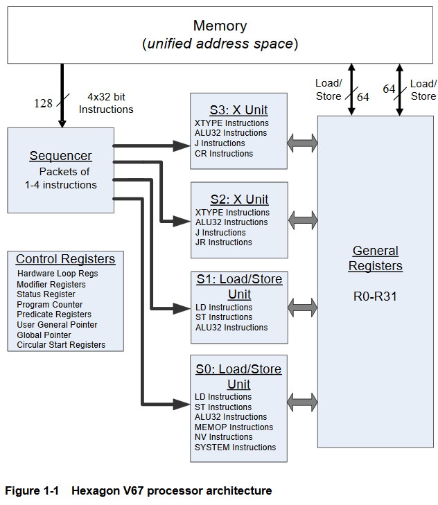
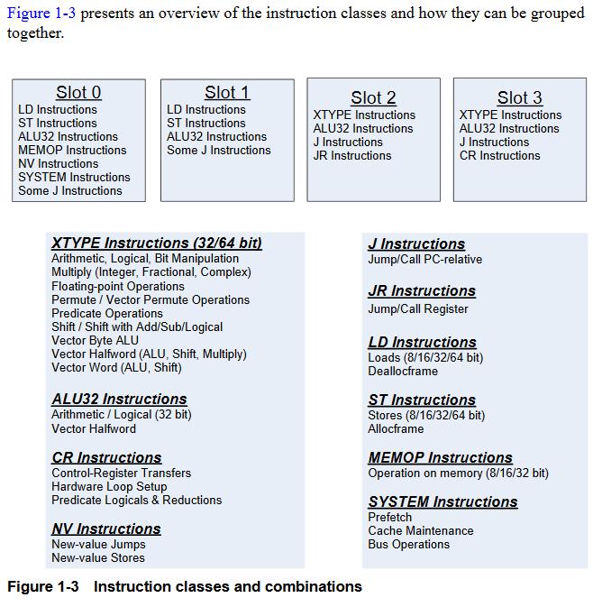
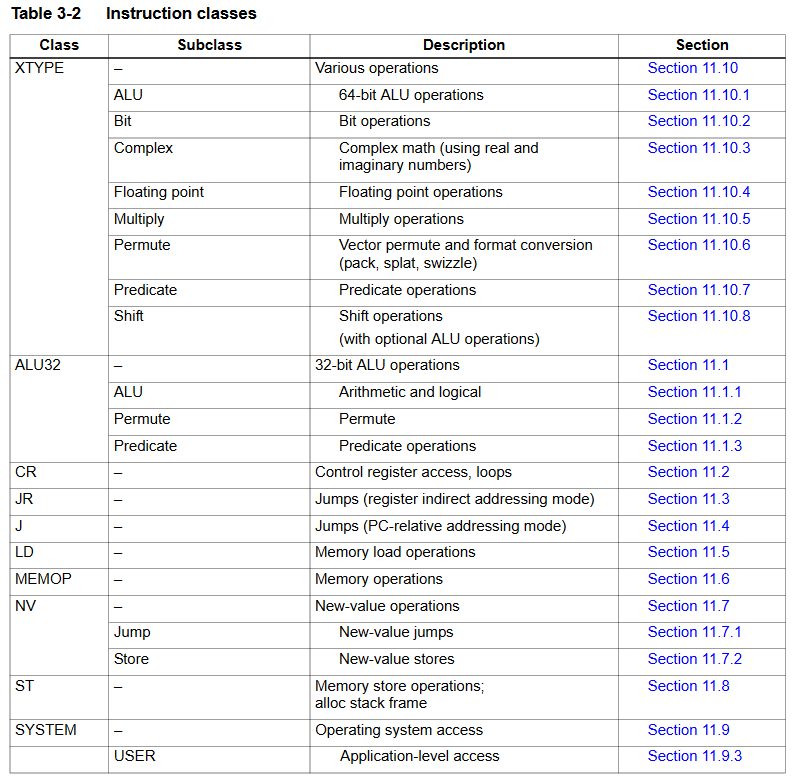
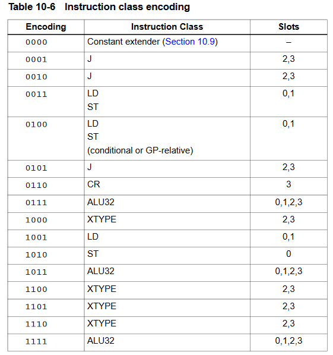

# Hexagon Summary Memo

## Architecture



- 32-bit address space
- 32개의 32-bit general register. 64-bit 연산을 하려면 register pair로 사용해야함.
- VLIW를 통해서 1개에서 4개의 instruction을 동시에 실행할 수 있음. (Parallel execution)
  - 그러나 위의 그림대로 Execution unit이 할 수 있는 일이 정해져있기 때문에 가능한 VLIW를 통해 가능한 instruction type이 제한됨.

## Control registers

The Hexagon processor includes a set of 32-bit control registers which provide access to processor features such as the program counter, hardware loops, and vector predicates. Unlike general registers, control registers can be used as instruction operands only in the following cases:

- Instructions that require a specific control register as an operand
- Register transfer instructions

For example:

```
R2 = memw(R0++M1)   // Auto-increment addressing mode (M1)
R9 = PC             // Get program counter (PC)
LC1 = R3            // Set hardware loop count (LC1)
```

### Loop Registers

The Hexagon processor includes two sets of loop registers to support nested hardware loops. Each hardware loop is implemented with a pair of registers containing the loop count and loop start address. The loop registers are modified implicitly by the loop instruction, but can also be accessed directly. For example:

```
loop0(start, R4)  // Modifies LC0 and SA0 (LC0=R4, SA0=&start)
LC1 = R22         // Set loop1 count
R9 = SA1          // Get loop1 start address
```

### Other registers

- User status register
- Modifier registers
- Predicate registers
  - Store the status results of the scalar and vector compare instructions
- Circular start registers
- User general pointer register
- Global pointer
- Cycle count registers
- Frame limit register
- Frame key register
- Packet count registers
- Qtimer registers

## Instructions

### Instruction classes







### Dot-new instructions

In many cases, a predicate or general register can be both generated and used in the same instruction packet. This feature is expressed in assembly language by appending the suffix “.new” to the specified register. For example:

```
{
P0 = cmp.eq(R2,#4)
if (P0.new) R3 = memw(R4)
if (!P0.new) R5 = #5
}
{
R2 = memh(R4+#8)
memw(R5) = R2.new
}
```

### Compound instructions

Certain common operation pairs (add-accumulate, shift-add, deallocframe-return, etc.) can be performed by compound instructions. Using compound instructions reduces code size and improves code performance.

### Duplex instructions

A subset of the most common instructions (load, store, branch, ALU) can be packed together in pairs into single 32-bit instructions known as duplex instructions. Duplex instructions reduce code size.

이 때 duplex 내의 연산들을 sub-instructions라고 부름. Duplex는 packet 입장에서 instruction 2개로 취급되며, slot 0과 1을 차지하게 됨. 한 packet 내에는 하나의 duplex와 두개의 non-duplex instruction이 가능함.

## Instruction packets

Instruction 1~4개가 같이 묶인 것을 instruction packet이라고 함. Instruction packet은 다음과 같이 실행됨.

1. Packet 내의 instruction의 source register를 parallel하게 read해옴.
2. Packet 내의 instruction이 모두 실행됨.
3. Packet 내의 instruction의 결과를 destination register에 parallel하게 write함.

그러므로 `{ R2 = R3; R3 = R2; }` 의 경우 swap의 역할을 하게 됨.

2번의 경우 일반적으로 instruction들이 parallel하게 실행되어야 하지만 예외가 일부 있음.

- Dual stores
- Dual jumps
- New-value stores
- New-value compare jumps
- Dot-new predicates

### Grouping constraints

- Dot-new conditional instructions must be grouped in a packet with an instruction that generates dot-new predicates
- ST-class instructions can be placed in Slot 1. In this case Slot 0 normally must contain a second ST-class instruction. 
- J-class instructions can be placed in Slots 2 or 3. However, only certain combinations of program flow instructions (J or JR) can be grouped together in a packet. Otherwise, at most one program flow instruction is allowed in a packet. Some Jump and Compare-Jump instructions can execute on slots 0 or 1, excluding calls, such as the following:
  - Instructions of the form `Pd=cmp.xx(); if(Pd.new)jump:hint <target>`
  - Instructions of the form `If(Pd[.new]) jump[:hint] <target>`
  - The `jump<target>` instruction
- JR-class instructions can be placed in Slot 2. However, when encoded in a duplex `jumpr R31` can be placed in Slot 0.
- Restrictions exist which limit the instructions that can appear in a packet at the setup or end of a hardware loop.
- A user control register transfer to the control register USR cannot be grouped with a floating point instruction.
- The SYSTEM-class instructions include prefetch, cache operations, bus operations, load locked, and store conditional instructions. These instructions have the following grouping rules:
  - brkpt, trap, pause, icinva, isync, and syncht are solo instructions. They must not be grouped with other instructions in a packet.
  - memw_locked, memd_locked, l2fetch, and trace must execute on Slot 0. They must be grouped only with ALU32 or (non-FP) XTYPE instructions.
  - dccleana, dcinva, dccleaninva, and dczeroa must execute on Slot 0. Slot 1 must be empty or an ALU32 instruction.

### Dependency constraints

한 packet 내에서 여러 instruction이 동일한 destination register에 적는 것은 불가능함. 하지만 일부 예외가 있음.

- Conditional writes are allowed to target the same destination register only if at most one of the writes is actually performed.
- The overflow flag in the status register has defined behavior when multiple instructions write to it. Instructions that write to the entire user status register (for example, USR=R2) are not allowed to be grouped in a packet with any instruction that writes to a bit in the user status register.
- Multiple compare instructions are allowed to target the same predicate register in order to perform a logical AND of the results.

### Ordering constraints

Packet의 binary encoding에서 instruction들은 slot 3에서 slot 0순으로 나타나야함. 만약 한 packet 내에 3개 이하의 instruction이 있다면 unused slot은 자동으로 skip되며, 꼭 nop으로 채워져있을 필요가 없음.

